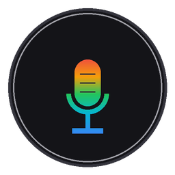

<div align="center">

🌐 [English Version](README.md) | **Español**

<br />



# agyIDE-voice-widget 🎙️

**Widget flotante discreto de dictado de voz nativo para Google Antigravity IDE.**  
*Audio ultraligero a 16 kHz mono, ganancia normalizada y pegado directo al chat de la IA mediante el portapapeles nativo de Windows (`CF_HDROP`).*

---

[](LICENSE)
[](https://www.microsoft.com/windows)
[](https://www.python.org/)
[](#-compatibilidad-verificada)
[](#-privacidad-y-seguridad-local)

</div>

> 📝 **Nota de Autoría:**  
> *Diseñado y conceptualizado por el autor, implementado mediante programación en conjunto con IA (Antigravity IDE).*  
> *(Herramienta comunitaria independiente, no afiliada oficialmente con Google LLC ni con el equipo de Antigravity).*

---

## 📑 Índice de Contenidos

* [💡 ¿Por qué este enfoque y no transcripción tradicional?](#-por-qué-este-enfoque-y-no-transcripción-tradicional-whisper--stt)
* [✨ Características Principales](#-características-principales)
* [🔍 Compatibilidad Verificada](#-compatibilidad-verificada)
* [🚀 Instalación Guiada (3 Opciones en 1 Clic)](#-instalación-guiada-3-opciones-en-1-clic)
* [📁 Estructura del Proyecto](#-estructura-del-proyecto)
* [▶️ Uso Diario y Atajos](#️-uso-diario-y-atajos)
  * [💡 Consejos de Ergonomía y Flujo Óptimo](#-consejos-de-ergonomía-y-flujo-óptimo)
* [🔒 Privacidad y Seguridad Local](#-privacidad-y-seguridad-local)
* [☕ Apoyo Comunitario (Meta de Hardware)](#-apoyo-comunitario-meta-de-hardware)
* [💼 Contacto y Oportunidades](#-contacto-y-oportunidades)
* [📄 Licencia](#-licencia)

---

## 💡 ¿Por qué este enfoque y no transcripción tradicional (Whisper / STT)?

La mayoría de utilidades de voz intentan convertir la voz a texto escrito (*Speech-To-Text*):
- Consumen gigabytes de memoria RAM y tarjeta gráfica (GPU) en tu computadora.
- Frecuentemente cometen errores o "alucinan" con nombres de funciones, variables, comandos de terminal o términos técnicos bilingües.

**`agyIDE-voice-widget` aprovecha la capacidad auditiva nativa de Antigravity IDE:**  
Antigravity IDE integra modelos multimodales de última generación (Gemini) con audición directa:
1. **La IA escucha tu voz real:** Comprende tu acento, pausas, entonación y vocabulario técnico exacto sin deformarlo.
2. **Consumo 0% de CPU en reposo:** No ejecuta modelos pesados en segundo plano; únicamente utiliza la captura de audio ligera y las APIs nativas de Windows.

---

## ✨ Características Principales

* 🔘 **Botón Flotante Nano (20 px):** Mínimo impacto visual. Arrástralo a donde quieras de tu pantalla; recuerda su posición entre reinicios.
* 🛡️ **Cero Robo de Foco (`WS_EX_NOACTIVATE`):** Puedes pulsar el botón o el HUD sin que el cursor abandone tu editor de código o tu terminal.
* ⏱️ **HUD de Telemetría en Tiempo Real:** Visualiza minutos, segundos (`MM:SS`) y megabytes acumulados (`MB`) con semáforo preventivo antes del límite de subida de Antigravity (~20 MB).
* ✕ **Cancelación Rápida con 1 Clic:** Si te equivocas o cambias de opinión al hablar, pulsa la **✕** del HUD para descartar la grabación de inmediato (sin guardar archivo ni pegar nada).
* ⌨️ **Atajo Global `F8`:** Inicia o detén la grabación cómodamente desde el teclado.
* 🔄 **Sincronización Inteligente con Antigravity IDE:**
  * Si minimizas Antigravity o usas otra ventana (ej. Google Chrome) en reposo, el botón se oculta automáticamente para no estorbar.
  * Si estás grabando y cambias de ventana o minimizas Antigravity, el botón permanece visible para que no pierdas el control.
  * Al regresar a Antigravity, el widget reaparece al frente al instante.
* 📋 **Resiliencia de Portapapeles:** Si al soltar la grabación la caja de texto del chat no tenía el foco activo, **el audio permanece listo en tu portapapeles de Windows**. Solo haz clic en el chat y presiona `Ctrl + V`.
* 🧹 **Auto-limpieza de Disco:** Las grabaciones locales temporales con más de 24 horas se eliminan automáticamente para no saturar tu almacenamiento.
* 🎙️🎙️ **Multi-Audio Consecutivo:** El widget adjunta el archivo en el chat sin presionar `Enter`. Puedes encadenar varias notas de voz consecutivas (parte 1, parte 2...) en un solo mensaje antes de enviarlo.
* ⚙️ **Conmutación desde Clic Derecho:** Puedes mover la posición del temporizador o activar/desactivar el inicio con Windows con un solo clic derecho sobre el botón.

---

## 🔍 Compatibilidad Verificada

* **Verificado y probado en:** **Antigravity IDE Version 2.6.0** (VSCode OSS Version 1.107.0, Windows 10/11 x64).
* **Python requerido:** Python 3.10 o superior (con la opción `Add python.exe to PATH` activada).

---

## 🚀 Instalación Guiada (3 Opciones en 1 Clic)

1. **Descarga o clona este repositorio:**
   ```bash
   git clone https://github.com/edgardyg987/agyIDE-voice-widget.git
   cd agyIDE-voice-widget
   ```
2. **Ejecuta el Asistente:**  
   Haz doble clic en **`instalar.bat`**.

El instalador descargará automáticamente las dependencias y te preguntará cómo prefieres usarlo:

| Opción | Modo de Inicio | Descripción |
| :--- | :--- | :--- |
| **`[1]`** | **Manual** | Crea un acceso directo en la carpeta del proyecto para iniciarlo a mano cuando lo necesites. |
| **`[2]`** | **Semi-automático** | Crea un **Acceso Directo con ícono Aurora propio en tu Escritorio** para iniciarlo con 1 clic. |
| **`[3]`** | **Automático (Recomendado)** | Se inicia solo en segundo plano con Windows. Siempre listo cuando abres Antigravity. *(Puedes desactivarlo cuando quieras con clic derecho en el botón).* |

---

## 📁 Estructura del Proyecto

```text
agyIDE-voice-widget/
├── instalar.bat         # 🚀 Asistente de instalación: único archivo a ejecutar
├── requirements.txt     # Dependencias de Python (sounddevice, pywin32, keyboard...)
├── README.md            # Guía completa en inglés (Portada principal)
├── README.es.md         # Guía completa en español
├── LICENSE              # Licencia libre MIT
└── src/                 # Código fuente interno y recursos visuales
    ├── agyIDE_voice_widget.py  # Motor principal del widget Win32
    ├── app_icon.ico            # Ícono oficial multirresolución Aurora
    ├── app_icon.png            # Arte original en alta definición
    └── mic_aurora_mini.png     # Micro-ícono vectorizado para el botón de 20px
```

---

## ▶️ Uso Diario y Atajos

* **Grabar / Detener:** Clic en el botón flotante o presiona la tecla `F8`.
* **Descartar grabación:** Clic en la `✕` roja del HUD mientras hablas.
* **Menú Contextual (Clic derecho sobre el botón):**
  * *Mover temporizador:* Alterna entre colocar el HUD a la izquierda o arriba del botón.
  * *Iniciar con Windows:* Alterna (`✓`) el arranque automático del sistema.
  * *Cerrar:* Cierra el widget completamente.

### 💡 Consejos de Ergonomía y Flujo Óptimo:
* **Foco en el Chat:** Haz clic en la caja de texto del chat de Antigravity antes o al soltar la grabación para que el audio se pegue automáticamente en el mensaje.
* **Si tenías seleccionado el Explorador de Archivos:** VS Code / Antigravity interpretará que deseas pegar el archivo `.wav` dentro de esa carpeta del proyecto y mostrará una ventana emergente de confirmación. ¡No te preocupes! Cancela el diálogo, haz un clic en el chat y presiona `Ctrl + V` (tu audio permanece seguro en el portapapeles).
* **Multi-Audio:** Puedes grabar un audio, soltar, grabar otro de inmediato y verás ambos archivos adjuntos en el mismo prompt. Presiona `Enter` manualmente cuando estés listo para enviar todo junto.
* **Límites de Envío en Antigravity IDE (20 MB / 5 Minutos):**  
  Antigravity IDE impone un límite estricto de **20 MB** por archivo adjunto (y una duración recomendada de hasta 5 minutos). Gracias a la optimización acústica a 16 kHz (~1.83 MB por minuto), el widget incluye un supervisor automático con semáforo visual en el HUD que corta de forma segura antes de alcanzar los 19.8 MB o 300 segundos, garantizando que Antigravity jamás rechace tu mensaje.

---

## 🔒 Privacidad y Seguridad Local

* **100% Fuera de Línea:** Este widget **no realiza conexiones de red**, no envía telemetría ni recopila información personal.
* **Aviso de Antivirus (Falsos Positivos):**  
  Para escuchar la pulsación de la tecla `F8` y simular el pegado automático con `Ctrl + V`, el código utiliza la librería `keyboard` y la API de Windows `user32.keybd_event`. Algunos antivirus advierten de forma genérica sobre programas que escuchan teclas (*falso positivo*). El código es 100% abierto y auditable en [`src/agyIDE_voice_widget.py`](src/agyIDE_voice_widget.py).

---

## ☕ Apoyo Comunitario (Meta de Hardware)

Este proyecto nació como una solución personal a una necesidad real de productividad al programar con Antigravity IDE, y lo comparto libremente con la comunidad.

> 🎯 **Meta Actual:** Estoy reuniendo fondos para actualizar los componentes de mi equipo de desarrollo (procesador y tarjeta madre) para poder seguir aprendiendo, programando y compartiendo utilidades abiertas.

Si este widget te ahorra tiempo o mejora tu flujo de trabajo, cualquier contribución voluntaria es inmensamente agradecida:

* ☕ [Invítame un café en Ko-fi](https://ko-fi.com/edgardyg987)
* 💳 [Donación directa vía PayPal.Me](https://paypal.me/edgardyg987)
* 🟡 **Binance Pay (USDT):** Pay ID / UID: `762714988` (Usuario: `EdgardyG`)

---

## 💼 Contacto y Oportunidades

Me apasiona resolver fricciones del día a día, optimizar flujos de trabajo y construir herramientas prácticas mediante asistencia de IA. Abierto a oportunidades de colaboración, automatización o proyectos donde pueda aportar soluciones funcionales y seguir aprendiendo.

* **Correo:** [edgardyg987@gmail.com](mailto:edgardyg987@gmail.com)

---

## 📄 Licencia

Distribuido bajo la **Licencia MIT**. Consulta el archivo [`LICENSE`](LICENSE) para más detalles. Eres libre de usar, modificar y distribuir esta herramienta sin restricciones.

