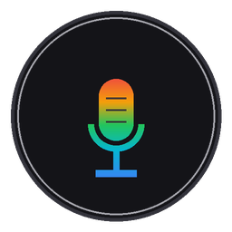

<div align="center">

🌐 **English** | [Versión en Español](README.es.md)

<br />



# agyIDE-voice-widget 🎙️

**Discreet floating native voice dictation widget for Google Antigravity IDE.**  
*Ultra-lightweight 16 kHz mono audio, normalized gain, and instant paste into the AI chat using native Windows clipboard (`CF_HDROP`).*

---

[](LICENSE)
[](https://www.microsoft.com/windows)
[](https://www.python.org/)
[](#-verified-compatibility)
[](#-privacy-and-local-security)

</div>

> 📝 **Authorship Notice:**  
> *Designed and conceptualized by the author, implemented through pair-programming with AI (Antigravity IDE).*  
> *(Independent community tool, not officially affiliated with Google LLC or the Antigravity team).*

---

## 📑 Table of Contents

* [💡 Why this approach instead of traditional transcription?](#-why-this-approach-instead-of-traditional-transcription-whisper--stt)
* [✨ Key Features](#-key-features)
* [🔍 Verified Compatibility](#-verified-compatibility)
* [🚀 Guided Installation (3 Options in 1 Click)](#-guided-installation-3-options-in-1-click)
* [📁 Project Structure](#-project-structure)
* [▶️ Daily Usage & Shortcuts](#️-daily-usage--shortcuts)
  * [💡 Ergonomics & Workflow Tips](#-ergonomics--workflow-tips)
* [🔒 Privacy & Local Security](#-privacy--local-security)
* [☕ Community Support (Hardware Goal)](#-community-support-hardware-goal)
* [💼 Contact & Opportunities](#-contact--opportunities)
* [📄 License](#-license)

---

## 💡 Why this approach instead of traditional transcription (Whisper / STT)?

Most voice dictation utilities attempt to convert speech to written text (*Speech-To-Text*):
- They consume gigabytes of RAM and GPU video memory on your machine.
- They frequently make mistakes, stutter, or "hallucinate" on technical variable names, terminal commands, function parameters, and bilingual coding jargon.

**`agyIDE-voice-widget` leverages the native audio capabilities of Antigravity IDE:**  
Antigravity IDE is powered by cutting-edge multimodal models (Gemini) with direct audio processing:
1. **The AI hears your actual voice:** It perceives your natural inflection, cadence, pauses, accents, and exact technical terminology without loss or corruption.
2. **0% CPU consumption at idle:** No bulky models running in the background; it solely relies on lightweight sound capture and native Windows Win32 APIs.

---

## ✨ Key Features

* 🔘 **Nano Floating Button (20 px):** Minimal visual footprint. Drag it anywhere across your monitors; it persists its position across restarts.
* 🛡️ **Zero Focus Stealing (`WS_EX_NOACTIVATE`):** Click the button or HUD without losing your active cursor position in your code editor or terminal.
* ⏱️ **Real-Time Telemetry HUD:** Displays live minutes, seconds (`MM:SS`), and accumulated file size (`MB`) with safety warning thresholds before hitting Antigravity's upload limit (~20 MB).
* ✕ **1-Click Quick Cancellation:** Made a mistake or changed your mind? Simply click the red **✕** on the HUD to immediately discard the recording (nothing is saved or pasted).
* ⌨️ **Global Hotkey `F8`:** Start and stop dictation effortlessly from your keyboard without touching the mouse.
* 🔄 **Smart Window Synchronization with Antigravity IDE:**
  * When idle, if you minimize Antigravity or switch to full-screen apps (e.g. Google Chrome), the widget automatically hides so it never clutters your screen.
  * When dictating, the button and HUD stay **permanently visible on top** even if you switch windows to consult notes.
  * Returning to Antigravity immediately restores the widget to the front.
* 📋 **Clipboard Resilience:** If the chat input was not focused when you stopped recording, **the audio file remains intact in your Windows clipboard**. Simply click the chat box and press `Ctrl + V`.
* 🧹 **Automatic Disk Cleanup:** Temporary audio files older than 24 hours are automatically purged to keep your disk lean.
* 🎙️🎙️ **Consecutive Multi-Audio:** Files are attached without pressing `Enter`. You can record multiple consecutive voice notes (Part 1, Part 2...) into the same prompt before sending.
* ⚙️ **Right-Click Context Menu:** Switch the timer position (`left` / `top`), toggle auto-startup with Windows, or close the widget with a single right-click.

---

## 🔍 Verified Compatibility

* **Tested & Certified on:** **Antigravity IDE Version 2.6.0** (VSCode OSS Version 1.107.0, Windows 10/11 x64).
* **Python Requirement:** Python 3.10 or higher (make sure `Add python.exe to PATH` is enabled).

---

## 🚀 Guided Installation (3 Options in 1 Click)

1. **Download or clone this repository:**
   ```bash
   git clone https://github.com/edgardyg987/agyIDE-voice-widget.git
   cd agyIDE-voice-widget
   ```
2. **Run the Assistant:**  
   Double-click on **`instalar.bat`**.

The installer automatically installs dependencies via `pip` and asks how you prefer to run it:

| Option | Launch Mode | Description |
| :--- | :--- | :--- |
| **`[1]`** | **Project Folder** | Creates a shortcut inside the project directory for manual on-demand launch. |
| **`[2]`** | **Semi-Automatic** | Creates a **Desktop Shortcut with the official Aurora icon** to launch with 1 click. |
| **`[3]`** | **Automatic (Recommended)** | Automatically starts in the background with Windows. Always ready when Antigravity opens. *(Toggleable anytime with right-click).* |

---

## 📁 Project Structure

```text
agyIDE-voice-widget/
├── instalar.bat         # 🚀 Interactive setup assistant: single entry point
├── requirements.txt     # Python dependencies (sounddevice, pywin32, keyboard...)
├── README.md            # Complete documentation (English - Main landing)
├── README.es.md         # Documentación completa en Español
├── LICENSE              # Open source MIT License
└── src/                 # Internal engine & visual assets
    ├── agyIDE_voice_widget.py  # Core Win32 widget engine
    ├── app_icon.ico            # Official multiresolution Aurora icon
    ├── app_icon.png            # High-definition artwork
    └── mic_aurora_mini.png     # Pixel-perfect 14x14 Aurora mic icon
```

---

## ▶️ Daily Usage & Shortcuts

* **Record / Stop:** Click the floating button or press `F8`.
* **Cancel recording:** Click the red `✕` on the live HUD while dictating.
* **Context Menu (Right-click the button):**
  * *Move HUD:* Toggle between placing the HUD to the left or top of the button.
  * *Start with Windows:* Toggle (`✓`) automatic startup with your PC.
  * *Close:* Exit the widget completely.

### 💡 Ergonomics & Workflow Tips:
* **Focusing the Chat:** Click inside the Antigravity chat text input before or upon stopping the recording so the audio file attaches automatically.
* **If File Explorer had focus:** Antigravity / VS Code may interpret that you are trying to paste the `.wav` file into the file explorer tree and will display a confirmation dialog. Don't worry: cancel the dialog, click the chat box, and press `Ctrl + V` (your audio file is safely retained in the clipboard).
* **Multi-Audio Prompts:** Dictate a note, release, dictate another, and both will attach to the same draft prompt. Press `Enter` manually when you are ready to send.
* **Payload Safeguards (20 MB / 5 Minutes):**  
  Antigravity IDE enforces a strict **20 MB** attachment limit. Thanks to our 16 kHz acoustic optimization (~1.83 MB per minute), the widget includes an automatic supervisor with visual HUD color alerts that cleanly finalizes the recording before reaching 19.8 MB or 300 seconds, guaranteeing Antigravity never rejects your message.

---

## 🔒 Privacy & Local Security

* **100% Offline & Private:** This widget **makes zero network requests**, sends no telemetry, and collects no personal data.
* **Antivirus Notice (False Positives):**  
  To listen for the global `F8` hotkey and simulate clipboard pasting via `Ctrl + V`, the tool uses the Python `keyboard` library and the Windows API `user32.keybd_event`. Generic heuristics in some antivirus software may flag keyboard-listening utilities as potential keyloggers (*false positive*). The code is 100% open and auditable in [`src/agyIDE_voice_widget.py`](src/agyIDE_voice_widget.py).

---

## ☕ Community Support (Hardware Goal)

This project was built to solve a real-world productivity bottleneck while coding with Antigravity IDE, and is shared freely with the global developer community.

> 🎯 **Current Goal:** I am raising funds to upgrade my development hardware (processor and motherboard) to continue learning, building, and sharing high-performance open-source agentic tools.

If this widget saves you time or boosts your coding flow, any voluntary donation is deeply appreciated:

* ☕ [Buy me a coffee on Ko-fi](https://ko-fi.com/edgardyg987)
* 💳 [Direct donation via PayPal.Me](https://paypal.me/edgardyg987)
* 🟡 **Binance Pay (USDT):** Pay ID / UID: `762714988` (User: `EdgardyG`)

---

## 💼 Contact & Opportunities

I am passionate about eliminating workflow friction, optimizing developer ergonomics, and crafting practical tools with AI assistance. Open to collaboration, automation engineering, and full-stack/agentic opportunities where I can deliver functional value.

* **Email:** [edgardyg987@gmail.com](mailto:edgardyg987@gmail.com)

---

## 📄 License

Distributed under the **MIT License**. See [`LICENSE`](LICENSE) for full details. You are free to use, modify, and distribute this software without restrictions.
